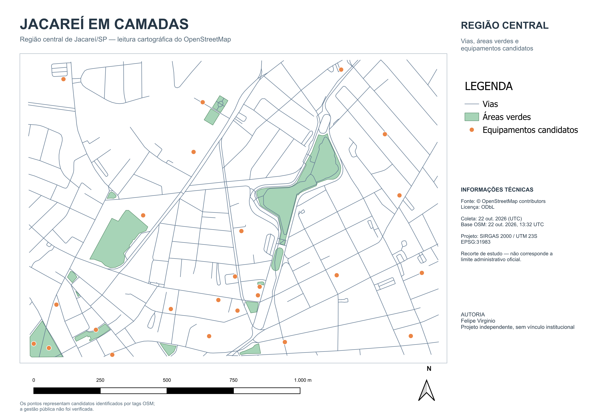

# jacareí em camadas

esse projeto nasceu da vontade de juntar duas áreas que fazem parte da minha trajetória: desenvolvimento de software e geoprocessamento. comecei explorando dados reais da região central de jacareí, usando o QGIS para trabalhar a composição cartográfica e o Python para automatizar coleta, validação e montagem do projeto.

acesse a primeira versão web: **[fezleep.github.io/jacarei-em-camadas](https://fezleep.github.io/jacarei-em-camadas/)**

o resultado desta primeira etapa é um mapa A4 com três camadas do OpenStreetMap: vias, áreas verdes e equipamentos candidatos.



## o que foi construído

- mapa cartográfico em PNG a 300 DPI e PDF com texto selecionável;
- projeto QGIS portátil em `EPSG:31983`;
- três camadas GeoJSON em `EPSG:4326`;
- coleta de dados reais pela Overpass API;
- validação de geometria, tipo e recorte com Python e Shapely;
- scripts PyQGIS para montar, finalizar e revisar o layout;
- testes automatizados com Pytest.
- aplicação web responsiva com navegação, pesquisa, filtros e popups;
- visualização das três camadas no Leaflet;
- consulta de proximidade em um raio de 500 m para pontos de interesse.

as camadas atuais são:

- `vias.geojson`: 334 feições lineares;
- `areas_verdes.geojson`: 14 polígonos;
- `equipamentos_candidatos.geojson`: 25 pontos.

## ferramentas

- QGIS 3.44 LTR e PyQGIS;
- Python 3;
- GeoJSON e Shapely;
- OpenStreetMap e Overpass API;
- Pytest.
- React, TypeScript e Vite;
- Leaflet e React Leaflet;
- Vitest e ESLint;
- GitHub Actions e GitHub Pages.

## como executar a aplicação web

com Node.js 24 e npm:

```powershell
cd web
npm ci
npm run dev
```

acesse `http://localhost:5173/jacarei-em-camadas/`.

para verificar e gerar a versão de produção:

```powershell
npm run lint
npm run test
npx tsc -b
npm run build
npm run preview
```

## como abrir o mapa

1. instale o [QGIS LTR](https://qgis.org/download/);
2. clone este repositório;
3. abra `qgis/jacarei_em_camadas_centro_portfolio_publicacao.qgz`.

o projeto usa caminhos relativos. mantenha as pastas `qgis/` e `dados/` na estrutura do repositório para que as camadas sejam encontradas automaticamente.

## como validar os dados

com Python 3.11 ou mais recente:

```powershell
git clone https://github.com/fezleep/jacarei-em-camadas.git
cd jacarei-em-camadas
python -m venv .venv
.\.venv\Scripts\python.exe -m pip install -r requirements.txt
.\.venv\Scripts\python.exe -m pytest -q
.\.venv\Scripts\python.exe scripts\validar_geojson.py
```

em Linux ou macOS, substitua `.\.venv\Scripts\python.exe` por `.venv/bin/python`.

o script `scripts/baixar_osm.py` refaz a consulta ao OpenStreetMap. como a base é atualizada continuamente, uma nova coleta pode produzir contagens diferentes das registradas nesta versão.

os scripts em `scripts/finalizar_mapa_portfolio.py`, `scripts/revisar_mapa_portfolio_v2.py` e `scripts/preparar_qgis_publicacao.py` precisam ser executados pelo Python fornecido pelo QGIS, não pelo ambiente virtual comum. o procedimento usado nesta entrega está em [documentacao/reproducao.md](documentacao/reproducao.md).

## fontes, créditos e licenças

os dados geográficos vêm do [OpenStreetMap](https://www.openstreetmap.org/) por meio da [Overpass API](https://wiki.openstreetmap.org/wiki/Overpass_API).

dados: © OpenStreetMap contributors, disponibilizados sob a [Open Database License — ODbL](https://www.openstreetmap.org/copyright). os GeoJSON derivados continuam sujeitos à ODbL e não são relicenciados pela licença do código deste repositório.

o código e a documentação autoral são disponibilizados sob a licença MIT. consulte [LICENSE](LICENSE) e [LICENSE-DATA.md](LICENSE-DATA.md) para entender a separação.

a coleta desta versão foi realizada em 22 de outubro de 2026. o timestamp registrado da base OSM é `2026-10-22T13:32:01Z`. mais detalhes estão em [documentacao/fontes.md](documentacao/fontes.md) e [documentacao/relatorio_coleta.json](documentacao/relatorio_coleta.json).

## limites do projeto

- o retângulo usado é um recorte de estudo, não o limite administrativo oficial do bairro Centro;
- o OpenStreetMap é uma base colaborativa e pode ter omissões ou classificações desatualizadas;
- os equipamentos são candidatos encontrados por tags OSM. a gestão pública não foi confirmada individualmente;
- pontos derivados de edifícios representam uma posição dentro da geometria, não uma entrada oficial;
- feições cortadas nas bordas podem estar incompletas;
- as contagens não devem ser tratadas como inventário oficial nem como indicador de cobertura ou acessibilidade.

este é um projeto independente e não possui vínculo com a Prefeitura Municipal de Jacareí.

## próximos passos

- integrar fontes oficiais de saúde e educação depois da revisão dos dados experimentais;
- acrescentar novas consultas espaciais;
- incorporar futuras camadas de sensoriamento remoto;
- continuar documentando as decisões e limitações conforme o projeto evoluir.

## continuar em outro computador

a primeira publicação foi preparada na branch `desenvolvimento/missao-04-web` e integrada à `main`. para obter a versão publicada em outro computador:

```powershell
git clone https://github.com/fezleep/jacarei-em-camadas.git
cd jacarei-em-camadas
git switch main
cd web
npm ci
npm run dev
```

a primeira versão web foi publicada a partir da branch `desenvolvimento/missao-04-web`, no commit [`bb1d8f1`](https://github.com/fezleep/jacarei-em-camadas/commit/bb1d8f13adbeaf4464b9c907d055aebc7eccffb4), e integrada à `main` pelo [Pull Request #1](https://github.com/fezleep/jacarei-em-camadas/pull/1), no merge `68d38be`.

os arquivos experimentais da investigação CNES/INEP da missão 04.2 permaneceram somente no computador original e não fazem parte desta publicação; eles não devem ser recriados nem substituídos a partir da versão pública.

## autor

feito por [Felipe Virginio](https://github.com/fezleep).
